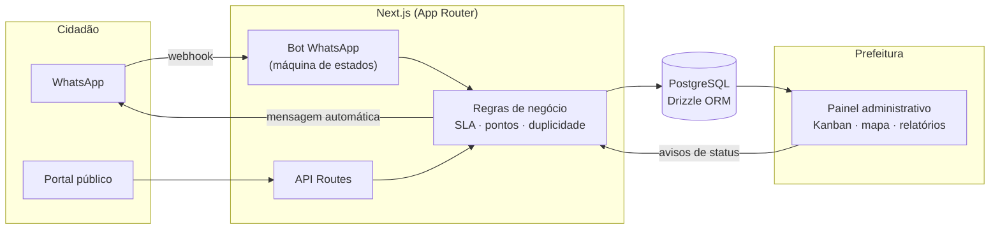

# 🏙️ Cidade em Dia

**Portal de zeladoria urbana participativa** — cidadãos reportam problemas da cidade (buracos, iluminação queimada, lixo, mato alto etc.) **pelo WhatsApp ou pelo site**, a prefeitura gerencia tudo em um **painel administrativo com prazos e custos**, e o cidadão acompanha o andamento e ganha **pontos de engajamento cívico**.

Projeto desenvolvido de ponta a ponta (produto, backend, frontend e integração com WhatsApp) para uma prefeitura parceira, atualmente em fase de implantação.

> Este repositório é uma **vitrine do projeto**: README detalhado + trechos de código selecionados que mostram como partes específicas do sistema foram resolvidas. O código-fonte completo é privado (projeto para cliente real, com dados de cidadãos) — posso mostrar mais em uma conversa técnica.


---

## O problema

Prefeituras pequenas e médias ainda recebem reclamações de infraestrutura por telefone, balcão ou redes sociais — sem protocolo, sem prazo, sem dado para gestão. O cidadão não sabe se o problema foi visto, e a prefeitura não sabe quanto tempo leva pra resolver cada tipo de chamado, nem quanto custa.

## A solução

Um canal único (WhatsApp, onde o cidadão já está) que vira um fluxo de trabalho completo:

```
Cidadão manda foto + localização no WhatsApp
        │
        ▼
Chamado entra no painel da prefeitura, com prazo e categoria automáticos
        │
        ▼
Equipe de campo atende → cidadão é avisado em cada etapa
        │
        ▼
Concluído → cidadão avalia, ganha pontos, chamado vira estatística pública
```

## Funcionalidades

**Para o cidadão**
- Denúncia pelo WhatsApp (bot conversacional) ou pelo site, com foto e localização obrigatórias por GPS
- Cadastro com validação de CPF (sem terceirizar para a Receita Federal — ver destaque abaixo) e troca de número de telefone com transferência de identidade/pontos
- Acompanhamento do chamado por protocolo, com linha do tempo
- Pontuação gamificada, níveis e resgate de prêmios
- Ranking público 100% anônimo (nome e foto nunca aparecem — ver destaque abaixo)

**Para a prefeitura**
- Painel kanban (A fazer / Em andamento / Concluído) com cores de prazo (SLA) automáticas
- Mapa de chamados e mapa de calor por categoria/bairro
- Relatórios de custo, tempo médio de resolução e produtividade por equipe
- Moderação de avatares/fotos de perfil enviadas pelos cidadãos
- Configuração de categorias, prazos, pontuação e prêmios sem precisar programar

**Privacidade (LGPD)**
- Telefone, nome completo e CPF nunca aparecem em páginas públicas
- Ranking mostra apenas um apelido e um avatar **gerados**, nunca o nome real
- CPF guardado apenas para evitar fraude/duplicidade — só o dígito verificador é conferido, não é consultado em nenhum serviço externo

## Arquitetura



## Stack

| Camada | Tecnologia |
|---|---|
| Frontend | Next.js 16 (App Router), TypeScript, Tailwind CSS 4 |
| Backend | API Routes do Next.js, lógica de negócio em TypeScript |
| Banco de dados | PostgreSQL 16 + Drizzle ORM (schema tipado, migrations) |
| Mensageria | WhatsApp Cloud API (Meta) — bot próprio, sem framework de terceiros |
| Mapas | Leaflet + OpenStreetMap/Nominatim (geocodificação) |

---

## Destaques de engenharia

Trechos reais do projeto, escolhidos para mostrar decisões de design — não o app inteiro.

### 1. Validação de CPF sem dependência externa

O cadastro exige CPF (para coibir contas duplicadas), mas o produto não podia depender de uma API paga/externa de consulta à Receita Federal. A validação roda 100% local, conferindo os dois dígitos verificadores pelo algoritmo oficial:

```ts
export function isValidCPF(raw: string): boolean {
  const cpf = onlyDigits(raw);
  if (cpf.length !== 11) return false;
  if (/^(\d)\1{10}$/.test(cpf)) return false; // recusa sequências tipo 111.111.111-11

  const calc = (len: number) => {
    let sum = 0;
    for (let i = 0; i < len; i++) sum += Number(cpf[i]) * (len + 1 - i);
    const r = (sum * 10) % 11;
    return r === 10 ? 0 : r;
  };

  if (calc(9) !== Number(cpf[9])) return false;
  if (calc(10) !== Number(cpf[10])) return false;
  return true;
}
```

### 2. Avatar anônimo determinístico (sem serviço externo, sem expor a foto real)

Por LGPD, o ranking público nunca pode mostrar nome nem foto do cidadão — mas precisava de algo visualmente identificável e **estável** (não pode mudar a cada carregamento, nem mudar se o cidadão trocar de número de telefone). A solução foi gerar um "identicon" SVG puro a partir de uma semente fixa, com um hash simples embutido (sem libs externas):

```ts
function hashSeed(seed: string): number[] {
  let h1 = 0xdeadbeef ^ seed.length;
  let h2 = 0x41c6ce57 ^ seed.length;
  for (let i = 0; i < seed.length; i++) {
    const ch = seed.charCodeAt(i);
    h1 = Math.imul(h1 ^ ch, 2654435761);
    h2 = Math.imul(h2 ^ ch, 1597334677);
  }
  h1 = Math.imul(h1 ^ (h1 >>> 16), 2246822507) ^ Math.imul(h2 ^ (h2 >>> 13), 3266489909);
  h2 = Math.imul(h2 ^ (h2 >>> 16), 2246822507) ^ Math.imul(h1 ^ (h1 >>> 13), 3266489909);
  const bytes: number[] = [];
  let x = h1 >>> 0, y = h2 >>> 0;
  for (let i = 0; i < 24; i++) {
    x = (Math.imul(x, 1664525) + 1013904223) >>> 0;
    y = (Math.imul(y, 22695477) + 1) >>> 0;
    bytes.push((x ^ y) & 0xff);
  }
  return bytes;
}
// → gera uma grade 5x5 simétrica em SVG (data URI), sem chamadas de rede,
//   sem custo e sem dependência de um serviço de avatar de terceiros.
```

A mesma semente também gera um apelido curto ("Guardião Atento #482"), nunca o nome real.

### 3. Localização só aceita por GPS, dentro do raio da cidade

Pra evitar denúncia falsa/fora da área de atuação, o backend recusa qualquer chamado cuja coordenada esteja fora do raio configurado da cidade — cálculo de distância real via fórmula de Haversine, sem depender de um serviço de geofencing pago:

```ts
export function haversineM(a: LatLng, b: LatLng): number {
  const R = 6371000;
  const toRad = (x: number) => (x * Math.PI) / 180;
  const dLat = toRad(b.lat - a.lat);
  const dLng = toRad(b.lng - a.lng);
  const s =
    Math.sin(dLat / 2) ** 2 +
    Math.cos(toRad(a.lat)) * Math.cos(toRad(b.lat)) * Math.sin(dLng / 2) ** 2;
  return 2 * R * Math.asin(Math.sqrt(s));
}

export function isWithinCity(p: LatLng): boolean {
  return haversineM(p, city.center) <= city.cityRadiusKm * 1000;
}
```

Isso é checado tanto no cliente (feedback imediato) quanto no servidor (defesa em profundidade) antes de qualquer chamado ser criado.

### 4. Detecção de chamados duplicados por proximidade

Problema real: várias pessoas reportam o mesmo buraco. Em vez de criar chamados repetidos (e poluir o painel da prefeitura), o sistema busca chamados abertos da mesma categoria num raio pequeno e, se achar, oferece "apoiar" o chamado existente em vez de abrir um novo:

```ts
export async function findNearbyOpen(categoryId: string, lat: number, lng: number) {
  const box = 0.0012; // ~130 m — filtro grosseiro por bounding box antes do cálculo exato
  const rows = await db.select().from(tickets).where(
    and(
      eq(tickets.categoryId, categoryId),
      inArray(tickets.status, ["ABERTO", "EM_ANDAMENTO"]),
      sql`${tickets.lat} between ${lat - box} and ${lat + box}`,
      sql`${tickets.lng} between ${lng - box} and ${lng + box}`,
    ),
  ).orderBy(desc(tickets.createdAt)).limit(10);

  // bounding box é só pré-filtro (usa índice); a distância real decide
  return rows.find((r) => haversineM({ lat, lng }, r) <= city.duplicateRadiusM) ?? null;
}
```

### 5. Cores de prazo (SLA) calculadas, nunca hardcoded

Cada categoria de chamado tem um prazo em horas. A cor que a prefeitura vê no painel (vermelho = atrasado, verde = concluído adiantado, neutro = dentro do prazo) é sempre derivada do estado real do chamado — nunca um campo fixo que pode ficar desatualizado:

```ts
if (x.status === "CONCLUIDO" && x.completedAt) {
  const ratio = (done - created) / slaMs;
  if (done > due) return { tone: "red", label: `Concluído com ${formatDuration(done - due)} de atraso` };
  if (ratio <= city.earlyThreshold) return { tone: "green", label: `Concluído ${formatDuration(due - done)} antes do prazo` };
  return { tone: "neutral", label: "Concluído dentro do prazo" };
}
```

A cor sempre vem acompanhada de ícone e texto (nunca só a cor), pra não depender de percepção de cor do usuário.

---

## Sobre este repositório

O código completo (schema do banco, bot do WhatsApp inteiro, painel administrativo, autenticação, seed de dados) está em um repositório privado — é um projeto para uma prefeitura real, com dados de cidadãos, então não faz sentido deixar tudo público. Esta vitrine existe pra mostrar **como** os problemas foram resolvidos, não para ser clonada e rodada.

Se quiser bater um papo técnico sobre decisões de arquitetura, modelagem do banco ou a máquina de estados do bot do WhatsApp, me chama — mostro mais com prazer.

## Autor

**Guilherme Cardoso Silva** — Análise e Desenvolvimento de Sistemas, Fatec Taquaritinga

[LinkedIn](https://linkedin.com/in/guilherme-cardoso-silva-dev) · guilherme.silva.17072004@gmail.com
